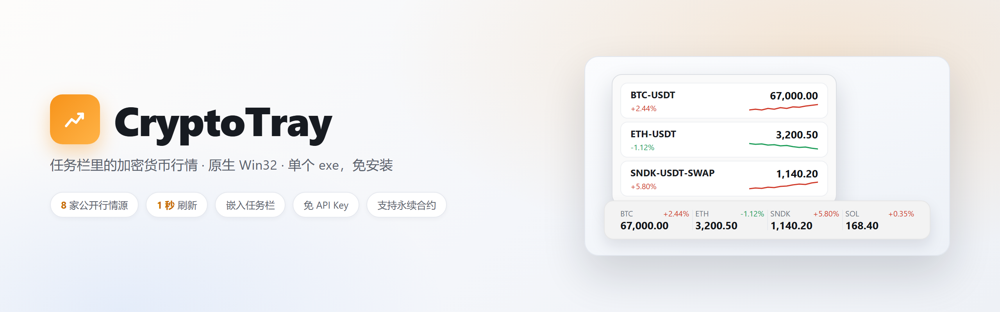
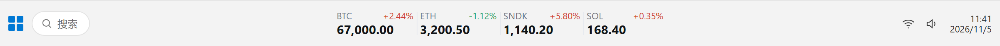
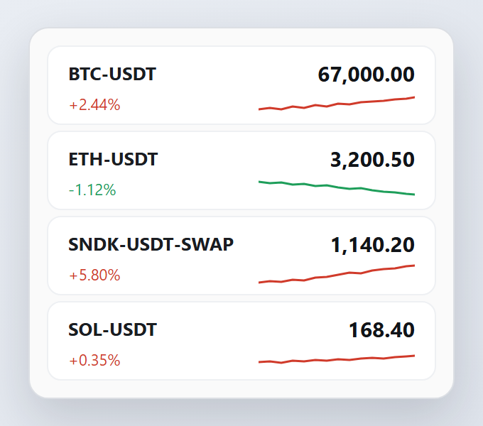
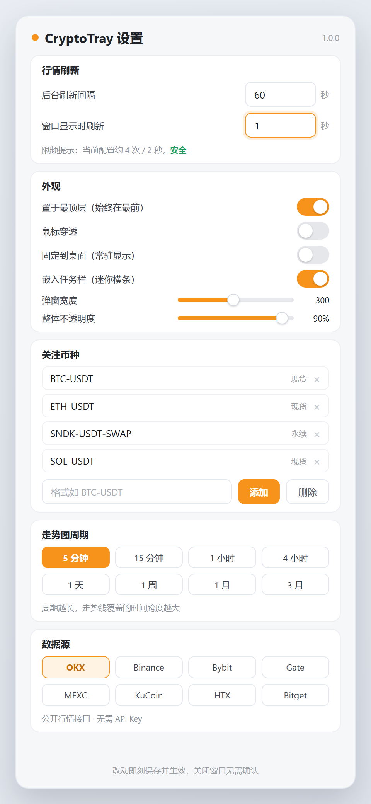

<p align="center">
  
</p>

<p align="center">
  <a href="https://github.com/mxcos-source/CryptoTray/releases/latest"></a>
  <a href="LICENSE"></a>
  
  
  <a href="https://github.com/mxcos-source/CryptoTray/releases"></a>
  <a href="#赞助支持"></a>
</p>

<p align="center">
  <b>任务栏里的加密货币行情</b> · 原生 Win32 · 单个 exe，免安装、免 API Key
</p>

---

**CryptoTray** 是一个轻量到几乎「隐形」的 Windows 桌面行情挂件。启动后常驻托盘，右键添加关注币种；勾选「嵌入任务栏」后，行情会以一条紧凑的迷你横条贴在任务栏上，点一下又能展开带走势图的浮窗。数据全部来自各交易所的**公开行情接口**——不需要注册、不需要填密钥。

> 涨跌颜色遵循国内习惯：**涨红**（`#D03A2A`）、**跌绿**（`#1E9E5A`）。

## 目录

- [界面预览](#界面预览)
- [功能特性](#功能特性)
- [数据源](#数据源)
- [下载与安装](#下载与安装)
- [使用](#使用)
- [从源码构建](#从源码构建)
- [项目结构](#项目结构)
- [技术要点](#技术要点)
- [已知限制](#已知限制)
- [赞助支持](#赞助支持)
- [免责声明](#免责声明)
- [License](#license)

## 界面预览

### 嵌入任务栏

<p align="center">
  
</p>

一个币种一格：上行为「代号 + 涨跌幅」，下行为价格。可沿任务栏拖到任意位置，位置自动记忆。

拖动时落点会**磁性吸附**：贴近任务栏左右两端，或者贴近别的悬浮控件（比如汽水音乐的播控卡片）左右两侧时自动吸上去；吸住之后要往反方向拖出一段距离才会脱离，手抖不会来回跳。没贴在吸附点上时就是自由跟随，只会在空档里落位——不会压住别人。拖到最右会把播控挤到左边，拖回来它自己让回原位，两边不会互相追着抖。

拖动时横条跟着光标走，同时一个**落点虚框**提前标出松手后的位置：贴近吸附点或撞到邻居时，虚框会和横条拉开距离，告诉你「松手就停在这儿」。位置没变化时虚框不出现，不会糊在横条上。

### 悬浮窗 + 走势图

<p align="center">
  
</p>

每个币种一行，右侧 30 根 K 线迷你走势线，趋势一眼可见。

### 设置

<p align="center">
  
</p>

刷新频率、外观、关注币种、走势图周期、数据源，全部改动**即时保存并生效**，无需点保存。

## 功能特性

| | 能力 | 说明 |
|---|---|---|
| 🧩 | **两种形态** | 嵌入任务栏的迷你横条 / 带走势图的悬浮窗，一键切换 |
| 🌐 | **8 家公开行情源** | OKX · Binance · Bybit · Gate · MEXC · KuCoin · HTX · Bitget，可随时切换 |
| 🈶 | **多语言** | 简体中文 / 繁體中文 / English，首次运行跟随系统语言，设置窗内一键切换（无需重启） |
| ⚡ | **秒级刷新** | 后台 / 前台两档刷新间隔，最短 1 秒 |
| 📈 | **涨跌跟随周期** | 显示所选周期窗口内的净涨跌，切换周期（5 分钟 ~ 3 月）后联动变化 |
| 🛡️ | **不卡顿、不排队** | 每个请求 1 秒硬超时；上一轮未完成则忽略，绝不堆积 |
| 💾 | **即时保存** | 配置原子写入（临时文件 + 原子替换），断电也不写坏 |
| 🪶 | **轻量** | 原生 Win32 + GDI，无第三方 UI 框架，单个 exe，静态链接运行库 |
| 🔁 | **支持永续合约** | 如 OKX 的 `SNDK-USDT-SWAP` |

## 数据源

| 平台 | 平台 ID | 行情接口 |
|------|---------|----------|
| OKX | `okx` | `GET /api/v5/market/ticker` |
| Binance | `binance` | `GET /api/v3/ticker/24hr` |
| Bybit | `bybit` | `GET /v5/market/tickers` |
| Gate | `gate` | `GET /api/v4/spot/tickers` |
| MEXC | `mexc` | `GET /api/v3/ticker/24hr` |
| KuCoin | `kucoin` | `GET /api/v1/market/stats` |
| HTX (火币) | `htx` | `GET /market/detail/merged` |
| Bitget | `bitget` | `GET /api/v2/spot/market/tickers` |

> 均为公开接口，无需 API Key；按 IP 有频率限制，程序已内置客户端限频预算。

## 下载与安装

前往 [**Releases**](https://github.com/mxcos-source/CryptoTray/releases/latest) 下载：

- `CryptoTray-<版本>-win64.zip`（如 `CryptoTray-1.0.2-win64.zip`）—— 解压后直接运行 `CryptoTray.exe`
- 适用 Windows 10 / 11（x64），**免安装**，单文件，无需 .NET / VC++ 运行库

> 首次运行如遇 SmartScreen 提示（未知发布者），点「更多信息 → 仍要运行」即可。

## 使用

1. 运行 `CryptoTray.exe`，托盘出现图标。
2. **右键托盘 → 设置**：
   - 在「关注币种」输入框填符号，点「添加」；
   - 选择数据源、走势图周期、刷新频率；
   - 勾选「嵌入任务栏（迷你横条）」变成任务栏横条。
3. **双击托盘图标**显示 / 隐藏浮窗。
4. 配置自动保存于 `%APPDATA%\CryptoTray\config.ini`。

> 托盘右键菜单里还有「置于最顶层 / 鼠标穿透 / 嵌入任务栏」等开关，以及「赞助支持」入口。

### 切换语言

设置窗右上角有三枚胶囊：**简体 / 繁體 / EN**。点一下立即切换——托盘菜单、悬浮窗、设置页全部就地重绘，**不需要重启**；选择会写入配置文件，下次启动保持。首次运行没有配置时会按系统 UI 语言自动选择。

### 币种写法

| 类型 | 写法 | 示例 |
|------|------|------|
| 现货 | `BASE-QUOTE` | `BTC-USDT`、`ETH-USDT` |
| 永续合约 | `BASE-QUOTE-SWAP` | `SNDK-USDT-SWAP` |

也兼容 `BTCUSDT`、`btc_usdt` 等写法，程序会自动归一化。

## 从源码构建

### 环境要求

- Windows 10 / 11（x64）
- Visual Studio（含「使用 C++ 的桌面开发」工作负载，提供 MSVC）
- CMake ≥ 3.20、Ninja

### 构建

1. 打开 `build.bat`，把顶部的 `VCTOOLS` / `SDKDIR` / `SDKVER` 改为你本机对应路径。
2. 运行：

```bat
build.bat
```

或手动：

```bash
cmake -S . -B build -G Ninja -DCMAKE_BUILD_TYPE=Release -DCMAKE_CXX_COMPILER=cl
cmake --build build
```

产物：`build/CryptoTray.exe`（静态链接 MSVC 运行库，单文件）。

### 附带测试

| 程序 | 用途 |
|------|------|
| `test_okx.exe` | 行情冒烟测试：`test_okx [platform] [instId] [bar]`，`test_okx all` 遍历全部平台 |
| `test_rate.exe` | 验证客户端限频在突发请求下是否生效 |
| `test_timeout.exe` | 验证慢接口会被 1 秒截止时间掐断 |

```bash
./build/test_okx.exe okx BTC-USDT 1h
./build/test_okx.exe okx SNDK-USDT-SWAP 1m
```

## 项目结构

```
.
├── src/
│   ├── main.cpp       # 托盘、悬浮窗、任务栏横条、设置界面
│   ├── market.cpp     # 多平台行情抽象：符号归一化、ticker / K 线请求与解析
│   ├── http.cpp       # WinHTTP 封装：超时、长连接复用、客户端限频
│   ├── config.cpp     # 配置读写（原子写入）
│   ├── i18n.cpp       # 三语文案表（简 / 繁 / EN），按 key 查表、缺译回退
│   ├── json.hpp       # 极简 JSON 解析器
│   ├── util.hpp       # 编码转换、锁等通用工具
│   └── market.hpp / http.hpp / config.hpp / i18n.hpp
├── test_okx.cpp       # 行情冒烟测试
├── test_rate.cpp      # 限频测试
├── test_timeout.cpp   # 超时测试
├── docs/screenshots/  # README 预览图
├── CMakeLists.txt
└── build.bat
```

## 技术要点

- **纯 Win32 + GDI 绘制**，无第三方 UI 框架，启动快、体积小。
- **分层窗口**（Layered Window）实现圆角、半透明、逐像素透明；任务栏横条用 `UpdateLayeredWindow` 合成，背景真正透出任务栏。
- **WinHTTP** 长连接复用；`WinHttpSetTimeouts` + 总 deadline 双保险，1 秒内必须返回。
- **单线程串行拉取 + 固定节拍**：刷新节奏由拉取线程自己掌握，不被消息队列延迟影响。
- **数据代数（generation）**：切换平台 / 币种 / 周期时作废旧轮请求，新配置立刻接管，不等旧请求。
- **文案单一来源**：所有界面文字收在 `src/i18n.cpp` 的三语表里（一行 = 一个 key + 三种语言），代码里只写 `TR(L"key")`；行情错误以机器键（`timeout` / `notfound` …）从数据层传出，由界面层翻译。

## 已知限制

- 仅支持 Windows。
- 公共接口按 IP 限频：币种多 + 1 秒刷新会撞到频控，此时数据约 1~2 秒一轮属正常现象。
- 不同平台对同一币种的现货 / 合约支持不同；若该平台没有此交易对，会提示「该平台无此交易对」。
- 预览图为界面示意，实际效果以运行为准。

## 赞助支持

CryptoTray 完全免费：没有会员、没有功能墙、没有内购，也不收集任何数据。如果它帮你省下了每天切浏览器看行情的时间，可以请作者喝杯咖啡 ☕

<p align="center">
  <a href="https://sponsor.mxcos.com"></a>
  <a href="https://afdian.com/a/mxcos"></a>
  <a href="https://github.com/sponsors/mxcos"></a>
</p>

<table align="center">
  <tr>
    <td align="center" width="50%">
      <br>
      <b>支付宝</b> · 扫码赞助
    </td>
    <td align="center" width="50%">
      <br>
      <b>微信</b> · 扫码赞助
    </td>
  </tr>
</table>

也可以在应用内直接打开：**托盘图标右键 → 赞助支持**。

**赞助纯属自愿**——不解锁任何功能，也不影响使用。所有赞助用于持续开发与多平台接口的测试开销。如果暂时不方便，给个 ⭐ **Star** 或帮忙反馈一个 Bug，同样是很大的支持。

> 感谢每一位使用者。你的 Star、Issue 和赞助，是这个项目能一直更新的原因。

## 免责声明

本项目仅供学习与个人使用。行情数据来自第三方交易所的公开接口，其延迟、准确性与可用性以各平台为准。**本项目不构成任何投资建议**。

## License

[MIT](LICENSE) © 2026 hackett
